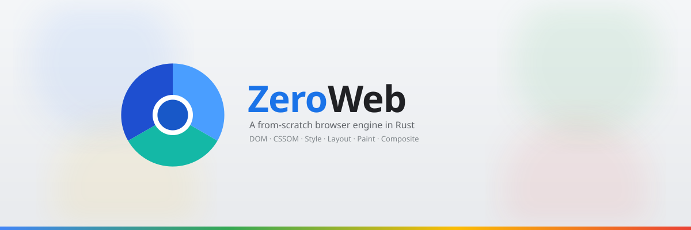
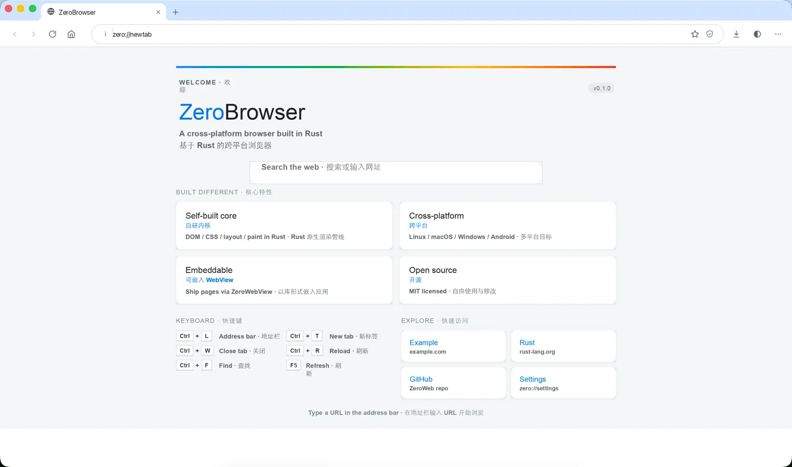

# ZeroWeb



[](https://github.com/leizongmin/ZeroWeb/actions/workflows/ci.yml)
[](https://github.com/leizongmin/ZeroWeb/releases)
[](https://www.rust-lang.org/)
[](LICENSE)
[](#现在做到哪了)
[](https://zeroweb.leizm.com)

ZeroWeb 是一个用 Rust 从头写的实验性跨平台浏览器，支持 macOS、Linux、Windows 和 Android。它交付两样东西：

- **`ZeroWebView`**：可嵌入其他应用的网页渲染库
- **`ZeroBrowser`**：基于同一内核的完整浏览器应用

DOM、CSS、布局、渲染、JavaScript 绑定、网络和安全边界都在这个仓库里实现，主要依赖宽松许可证的 Rust 组件。

这也是一个 AI-first 的工程实验：人只负责方案设计、关键决策和结果验证，代码几乎全部由 AI 编写。我们想看看，在架构边界、测试和验收都写清楚的前提下，AI 能把浏览器这种复杂系统推进到什么程度。

> [!IMPORTANT]
> 项目处于实验阶段，**不是日常可用的浏览器**。它适合学习、研究和工程探索。商用或生产用途请自行评估功能、安全、兼容性、性能和许可证风险。



## 为什么做这个项目

- **嵌入优先**：除了浏览器应用，还要提供稳定的 Rust `ZeroWebView` API，方便其他应用直接集成。
- **许可证边界清楚**：主线依赖优先选 MIT、Apache-2.0、BSD 等宽松许可证，核心能力不受 copyleft 约束。
- **Rust 全栈**：页面内核、宿主层和渲染基础设施尽量都在 Rust 生态内完成。
- **AI 可以写，但要能审**：每个改动都要讲得清、测得到、看得见。

## 现在做到哪了

状态说明：✅ 基础能力可用并有测试覆盖；🚧 在推进，还不完整；⏳ 计划中。

| 能力 | 状态 | 现状 |
|------|------|------|
| 桌面浏览器 | ✅ | macOS / Linux / Windows 真窗口；多标签、地址栏、下载、右键菜单、缩放、页面查找、收藏、历史、设置 |
| Android 浏览器 | ✅ | Kotlin/Compose 界面 + Rust 内核；多标签、键盘与输入法、下载、通知、中英双语 |
| 多进程架构 | ✅ | 渲染、图像解码、合成分别在独立进程；页面脚本只在渲染进程内运行 |
| 嵌入 API `ZeroWebView` | ✅ | 稳定 API 与 demo，接入 Service Worker、WASM 和安全检查 |
| HTML / CSS 渲染 | 🚧 | 上游 WPT reftest 约 93% 通过（15,431 / 16,590，2026-10-16） |
| JavaScript 与 DOM | 🚧 | V8 / QuickJS 双引擎，原生 DOM 绑定，Web Components、Worker、ES Modules |
| 网络、存储与安全 | ✅ | HTTP/1.1 和 HTTP/2、Cookie、IndexedDB、Cache API、OPFS、Service Worker；CSP、HSTS、混合内容阻止、站点隔离 |
| 编辑与输入 | ✅ | contenteditable、Selection、键盘默认动作、剪贴板、全屏 |
| 媒体 | 🚧 | VP9 / AV1 / H.264 视频，MP3 / Vorbis / Opus / AAC 音频，基础 Web Audio |
| 自动化与调试 | ✅ | WebDriver、CDP（可被 Playwright 驱动）、复用 Chrome DevTools 前端的调试面板 |
| WebGL / WebGPU | ⏳ | 尚未进入主线 |

上表是概要。按里程碑的进度见 [路线图](ROADMAP.md)，各领域的兼容性数字见 [官网进度页](https://zeroweb.leizm.com/progress.html)。

## 还缺什么

- **真实网站兼容性**：静态页面渲染接近可用，但登录、复杂脚本、长会话等真实站点交互还没系统验收。
- **Web API 覆盖**：部分 API 还在补齐，例如拖放、Pointer Lock、Web Crypto；WebGL / WebGPU 尚未开始。
- **性能**：还没用 Speedometer、JetStream 等基准做系统优化。
- **完整产品体验**：没有扩展系统、没有 WebRTC，完整媒体播放体验也不是近期重点。
- **正式发布**：目前只有每周预发布构建，还没有稳定版本。

## 试一下

**下载预构建包**：在 [Releases](https://github.com/leizongmin/ZeroWeb/releases) 下载每周构建（`weekly-*`），提供 Linux、macOS、Windows 版本。这些都是实验性预发布，macOS 版可能需要在“系统设置 → 隐私与安全性”里手动放行。

**从源码运行**：先按 [Linux 和 macOS](docs/development/linux-macos.md) 或 [Windows](docs/development/windows.md) 文档配置环境，然后：

```bash
git clone https://github.com/leizongmin/ZeroWeb.git
cd ZeroWeb
make browser
```

更多构建、测试和运行方式见 [构建、测试与本地运行](docs/development/building-and-testing.md)。

## 了解更多

| 文档 | 说明 |
|------|------|
| [架构总览](docs/architecture.md) | 整体分层、32 个 workspace member 的职责、从请求到像素的链路 |
| [路线图](ROADMAP.md) | 已完成、进行中和计划中的里程碑 |
| [构建、测试与本地运行](docs/development/building-and-testing.md) | make 命令、测试门禁、reftest、本地入口 |
| [打包与发布](docs/releases/packaging.md) | 各平台打包、macOS 签名公证、自动发布 |
| [文档索引](docs/README.md) | 规格、进度控制面、调研和治理文档 |
| [CHANGELOG.md](CHANGELOG.md) | 对外变更记录 |

## 参与贡献

欢迎贡献，包括 AI 辅助的贡献。提交前请先阅读 [CONTRIBUTING.md](CONTRIBUTING.md) 和 [贡献责任说明](docs/governance/contribution-responsibility.md)，并遵守 [行为准则](CODE_OF_CONDUCT.md)。安全问题请按 [SECURITY.md](SECURITY.md) 私下报告。

## 许可证

本项目采用 [MIT License](LICENSE)。MIT 允许商用和二次集成，但项目仍是实验性质，用于生产前请自行评估风险。新增第三方依赖前请先确认许可证与项目策略兼容。
